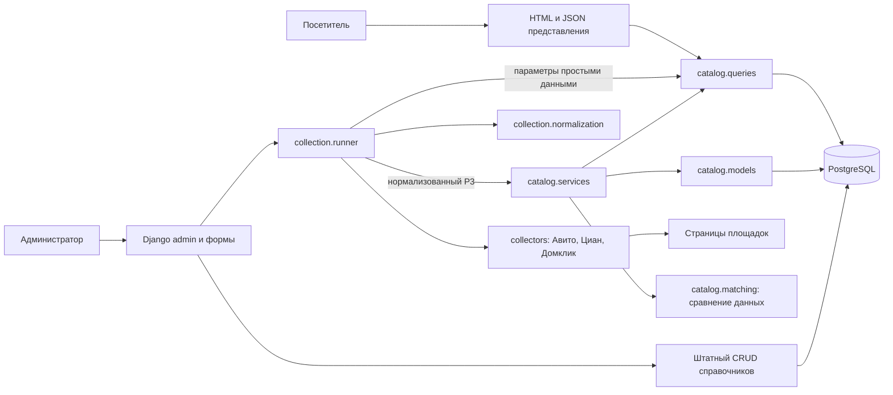
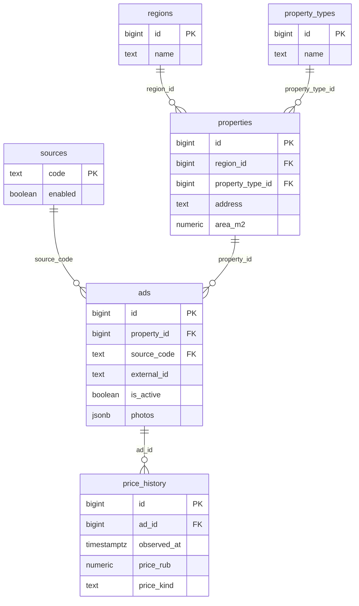
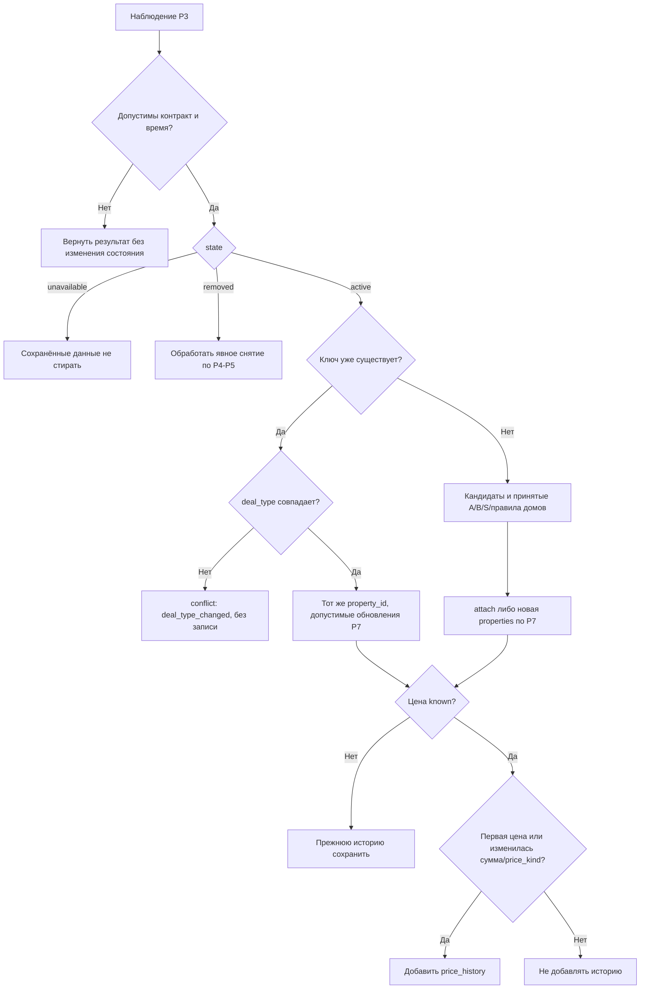

# 9 — сводный проект и итоговая сверка

**ПРЕДЛОЖЕНИЕ ПУНКТА 9, НЕ ПРИНЯТО.** 18 ноября 2026. Пункты 1–8, включая 8.5, приняты и закрыты как проектирование. Ниже сводка уже принятых решений и отдельно новые предложения оформления/эксплуатации. Код, рабочие конфигурации, установка и испытания ещё не выполнены. Пункт 9 не закрывается этим документом автоматически.

## 9.1. Действующий проект: единый указатель решений

Это сводное описание. Детальные принятые контракты остаются в указанных документах; их поля/пороги/права не переопределяются сокращённой схемой. При споре проверить позднее прямое решение владельца и действующую спецификацию, а не брать старый TECHNICAL-DESIGN.md или исторический абзац.

| Область | Принятое решение | Точный источник |
|---|---|---|
| Назначение | Собирать жилую недвижимость из Авито/Циан/единого Домклик, нормализовать, автоматически сопоставлять, показывать каталог/карточку/JSON, управлять сбором. Продажа/месяц/сутки, квартиры/комнаты/дома. | [PLAN](PLAN.md), [НИР §§4–5](../thesis/nir/body.md), [источники 6](POINT6-REMAINING-DESIGN.md) |
| Архитектура | Один Django-проект, два apps: collection и catalog. Извлечение/нормализация/runner отдельно от приёма/сопоставления/ORM/представлений. | [Структура](INDEPENDENT-STRUCTURE.md), [8.3 §2.1](QUALITY-8.3-PROPOSAL.md) |
| Данные | Только sources, regions, property_types, properties, ads, price_history плюс штатные Django-таблицы. Характеристики недвижимости в properties, публикационные сведения в ads; JSONB только принятого списка фото-URL. | [Пункт 2](DB-POINT2-VERIFIED-DRAFT.md) |
| Контракт P3/P7 | Одна публикация на входе, source/key/observed_at/state; active/removed/unavailable различаются. Для новой публикации matching решает attach/create и допустимый property_patch; повтор ключа сохраняет property_id. | [P3–P8](DB-POINT2-VERIFIED-DRAFT.md) |
| Атомарность/цены | Сериализованная атомарная запись, сеть до транзакции. Уникальный (source_code,external_id). История добавляется при изменении (price_rub,price_kind), прежние строки неизменяемы для runtime-роли. Новая недоступная цена не стирает прежнюю. Другой deal_type у прежнего ключа — conflict с reason=deal_type_changed. | [Пункт 2](DB-POINT2-VERIFIED-DRAFT.md), [суточные цены](DAILY-BASE-PRICES-6.4-PROPOSAL.md) |
| Сопоставление | Квартиры A/B с проверкой общих известных характеристик; комнаты строгий S, дома — принятые условия дома/блока/участка. Нехватка доказательств/противоречие не вынуждает attach. Принятые риски ошибок не превращаются в гарантию. | [Квартиры](MATCHING-PROPOSAL.md), [комнаты](ROOM-MATCHING-6.2-ACCEPTED.md), [дома](HOUSE-MATCHING-6.3-ACCEPTED.md) |
| Фото | Только URL; без файлов, хешей и обработки байтов. Сломанная ссылка/недоступный внешний ресурс не означает снятие объявления. | [Пункт 2](DB-POINT2-VERIFIED-DRAFT.md), [карточка](PROPERTY-CARD-PROPOSAL.md) |
| Получение | Playwright извлекает встроенные данные страницы; фактические семейства/ключи из 6.1/6.4, не выдуманный универсальный API. Исключение гостиничных номеров по проверенным признакам, не одному слову hotel. | [Нормализация](NORMALIZATION-4.2-PROPOSAL.md), [6](POINT6-REMAINING-DESIGN.md), [гостиничные номера](HOTEL-ROOMS-6.4-PROPOSAL.md) |
| Обход | Один последовательный run, один retry сети/5xx, 30 секунд на попытку; 401/403/429/служебная проверка завершают источник. Повтор ID сам не останавливает пагинацию. Повторный запуск идёт сначала, повторные записи не плодятся. | [4.3](COLLECTION-4.3-PROPOSAL.md) |
| Управление | Штатные auth/admin/forms; параметры запуска временные, sources.enabled постоянный. Состояние/идентификатор/журнал принадлежат runner, не таблицам collection_runs/logs. Устаревший stop не останавливает новый run. Удаление справочников при активном/неопределённом run отклоняется сервером. | [Параметры](SOURCE-PARAMETERS-PROPOSAL.md), [5.4](ADMIN-SCREENS-PROPOSAL.md), [5.5](JSON-ROUTES-LAYOUTS-PROPOSAL.md) |
| Интерфейс | Одна квартира с отдельными ads и ценами. Каталог группирует и пагинирует properties после фильтрации подходящих ads; карточка показывает все ads, в том числе снятые. Контекст поиска в URL, типы/ошибки HTML/API согласованы. | [Каталог](CATALOG-SCREEN-PROPOSAL.md), [карточка](PROPERTY-CARD-PROPOSAL.md), [JSON](JSON-5.5-CONTRACT-DETAILS.md) |
| Приёмка | F01–F25, включая повтор/историю/гонки/права БД. Локальная fixture, настоящая БД, браузер и живой источник — разные доказательства. | [7.1](ACCEPTANCE-7.1-PROPOSAL.md) |
| Исследование | 600 публикаций + отдельные 100 сложных реальных пар; независимая разметка/полный реестр, разделение групп 70/30. M0/M1/M2 на общем срезе, метрики/неопределённость/группы/затраты, 5 повторов и 5 порядков. Пользовательская проверка: 4 человека, по 3 задания каждым способом, без жёсткого лимита. | [7.2](RESEARCH-DATASET-7.2-PROPOSAL.md), [7.3](RESEARCH-METRICS-7.3-PROPOSAL.md), [7.4](USER-TIME-STUDY-7.4-PROPOSAL.md) |
| Качество | Ruff/mypy/djLint; strict весь собственный Python, включая тесты/миграции; слои, AAA, минимальные проверки по риску, pre-commit check-only, CI отдельно от живых площадок. | [8.1](QUALITY-8.1-PROPOSAL.md), [8.2](QUALITY-8.2-PROPOSAL.md), [8.3](QUALITY-8.3-PROPOSAL.md), [8.4](QUALITY-8.4-PROPOSAL.md) |
| Версии | Python3.13.18/Django5.2.19/PG17.12/psycopg3.3.9; mypy1.19.1/stubs-ext5.2.9; остальные точные pins/CI SHA/digest приняты. Подтверждённая metadata не равна совместной установке. | [8.5](QUALITY-8.5-PROPOSAL.md) |

### Сквозной пример

Новая публикация Циан: collector получает страницу и поля → normalization формирует P3 → runner передаёт P3 в catalog.services → внутри сериализованной операции проверяются время/ключ/поля, queries выбирает кандидатов, matching возвращает create либо attach/patch → атомарно сохраняются properties/ads/пригодная цена. Новая публикация Домклик той же квартиры присоединяется к property_id только при выполнении принятого правила; остаётся второй ads со своей ценой/описанием/URL. Ручного merge нет. Повтор того же ключа обновляет прежнюю ads, не ищет другой property_id. Точная последовательность проверок и исключений задаётся P3–P8, не сокращённым примером.

## 9.2. Схемы принятых решений — проектные представления

Ниже новые представления, не новые предметные правила. Mermaid — редактируемые исходники схем, не заявление о готовой вёрстке графического комплекта ВКР или соответствии блок-схем ГОСТ. Названия entities совпадают с БД, а не навязывают имена Python-классов.

### Схема компонентов и ответственности



Стрелка — зависимость/вызов, не направление копирования результатов; collector возвращает данные runner, normalization — нормализованный контракт. Допустимый прямой CRUD справочников не разрешает ручную правку связей/истории. Общие инварианты БД и запрет удаления при run действуют и здесь. Техническая PG-блокировка runner по 4.3 не является предметным ORM-доступом.

### Логические связи БД



Поля сокращены только для читаемости схемы: полная физическая спецификация, NULL/UNIQUE/CHECK/FK/права в пункте 2. Это не предложение урезать таблицы. Ни group_id/duplicate_of_id, ни отдельной таблицы фото нет. Штатные auth/admin-таблицы Django в шесть предметных не входят.

### Последовательность приёма объявления

```mermaid
sequenceDiagram
    participant R as collection.runner
    participant C as collector
    participant N as normalization
    participant S as catalog.services
    participant Q as queries
    participant M as matching
    participant D as PostgreSQL
    R->>C: Получить карточку
    C-->>R: Извлечённые данные или результат ошибки
    R->>N: Нормализовать полученные поля
    N-->>R: Нормализованные значения или ошибка разбора
    R->>S: Передать P3 при допустимом конверте
    Note over S,D: Проверки P3 и сериализованная атомарная операция P5
    S->>D: Найти публикацию по source/key и проверить observed_at
    alt снимок допускается к обработке и ключ новый
        S->>Q: Получить кандидатов
        Q->>D: Прочитать текущие свойства
        Q-->>S: Данные кандидатов
        S->>M: Сопоставить и определить допустимый patch
        M-->>S: attach/create/результат по P7
    else известный ключ либо снимок не допускается
        Note over S,D: Прежний property_id; ignored/rejected/conflict по P3-P8
    end
    S->>D: Разрешённые записи либо отсутствие изменений; commit/rollback
    S-->>R: outcome, ID при наличии, price_changed, причина
```

Это обобщённая схема: removed/unavailable не обязаны иметь полный active-набор и не запускают сопоставление новой недвижимости. Нормализация не заменяет причину ошибки значения на NULL; цена/фото имеют принятые частичные статусы. Если приём возвращает ignored/rejected/conflict, стрелка к DB означает отсутствие разрешённых изменений, а не обязательный commit новой строки.

### Схема решений при повторе и цене



Обобщение не меняет атомарность/порядок P5 и не вводит новые пороги. Подробные схемы нормализации, отдельных A/B/S/домов и обхода с пагинацией/остановкой оформляются по принятым алгоритмам в графический комплект; настоящее представление не выдаётся за все окончательные блок-схемы отчёта.

## 9.3. Маршруты и проверяемая связность

| Пользовательский проход | Маршруты | Контракт / будущая приёмка |
|---|---|---|
| Найти и открыть объект | / → /catalog/ → /properties/<id>/ | Общие фильтры/пагинация 5.5, возвращение к результатам с URL-контекстом; F16–F18 по точной матрице 7.1 |
| Получить те же данные | /api/properties/ и /api/properties/<id>/ | JSON 5.5, decimal-строки/NULL/ошибки/пагинация; F18, доступ F19 по точной матрице 7.1 |
| Управлять запуском | /admin/login/, /admin/collection/, start/stop POST | Штатные права/CSRF, единственный run, адресный stop, журнал; F19–F23 по 7.1 |
| Источники/справочники | Штатные model admin разделы | Enabled и CRUD, запреты удаления/гонки и права F22/F25 |
| Журнал/выход | /admin/collection/logs/, /admin/logout/ POST | Последние ошибки и состояния, очистка ресурсов по 4.3; logout не останавливает run |

Имена F здесь — навигационная привязка, точный состав каждой проверки берётся из неизменённой матрицы 7.1. Других HTML/API маршрутов и новых CRUD-страниц не вводим. Формирование admin URL и регистрация custom routes по 5.5, без перехвата admin catch-all.

## 9.4. Новое предложение: установка, локальный показ и восстановление

Это отдельные решения пункта 9, пока НЕ ПРИНЯТЫЕ. Предлагаем минимальный локальный учебный запуск: приложение из uv-окружения 8.5, PostgreSQL17.12 как отдельная зависимость; runserver только на 127.0.0.1 для разработки/демонстрации. Публичный сервер, Gunicorn/Nginx, облако, домен и автоматический деплой в объём не добавляются. runserver не называется production-развёртыванием. Способ установки PostgreSQL не меняет предметный проект; разрешённая настройка использует принятый образ/версию 8.5 либо эквивалентную установку этой версии, с явным владельцем ресурсов.

Воспроизводимый маршрут будущего оператора:

1. Получить согласованный Git commit, точные Python/uv/PG/browser, uv sync --locked, отдельные настройки/секреты вне Git; проверить версию среды. Пример конфигурации не содержит настоящих паролей. Подготовить свою прикладную БД и роли, не использовать пользовательские/production данные для тестов.
2. Для чистой установки миграции выполняются служебной ролью владельца схемы; обычное приложение работает непривилегированной runtime-ролью. Предлагаем два отдельных набора credentials. Runtime не владеет схемой и не superuser; price_history доступна ему на SELECT/INSERT, не UPDATE/DELETE; остальные права/FK/инварианты соответствуют P6/F25. Учетные записи Django auth — другой уровень, не PostgreSQL-роли.
3. Подготовить справочники/включённые поддержанные источники, отдельного администратора и контролируемый демонабор без секретов. Имена/коды соответствуют принятым источникам/P3, а не догадкам. Локально проверить каталог → карточку → JSON → вход/сбор/остановку/журнал; реальные внешние запросы проверяются отдельно от демонабора.
4. Каждый агент/задача использует отдельную проверочную БД и свои app/browser процессы; общий стек не запускается/не останавливается вслепую. До внедрения запуска нужен реально работающий учёт владельцев/очистка согласно пользовательским правилам. Существующий механизм сначала ищется; если его нет, отсутствие фиксируется, совместное использование не выдаётся за безопасное. Это требование к реализации окружения, а не созданный здесь runner или обещание автоматики. После проверки освобождаются только ресурсы задачи; постоянные данные не удаляются.
5. Для воспроизводимого показа: зафиксированный Git commit/lock/миграции, подготовленный снимок каталога и сценарий по 7.1; короткая запись резервного показа после появления программы. Без сети работают сохранённые текстовые данные и история; фото только по URL, при недоступности — принятое состояние без изображения. Offline-наличие исходных площадок/изображений не обещается; резервный показ не заменяет функциональные испытания.

Резервирование предлагаем ручное, перед обновлением схемы/демонстрацией; без нового расписания/сервиса. Доверенный pg_dump17.12 -Fc одной прикладной БД хранится приватно вместе с указанием версии/commit, отдельно от открытого Git. Он содержит и штатные Django-таблицы, потенциально чувствительные данные, а не только шесть предметных. Код/lock/миграции и отдельно подготовленные секреты нужны дополнительно. Фото-файлов нет; текущий процесс/активный run из backup не возобновляем.

Проверка восстановления: создать отдельную пустую БД под служебной ролью, восстановить через pg_restore --single-transaction --no-owner --no-acl; роли и минимальные права runtime создать/назначить явно, затем проверить F25. Владельцы и ACL намеренно не копируются из архива; pg_dump одной БД вообще не сохраняет глобальные роли. В рабочую БД архив не накатывается. Восстановленную схему сверить с commit/миграциями, затем проверить количество/связи/историю и каталог/карточку/JSON от runtime-роли. Только успешное восстановление и сценарий подтверждают результат; факт создания dump/чтения оглавления недостаточен. Для чистой установки с нуля используются migrate, а для восстановления полного schema+data архива в пустую БД перед restore не создаются те же таблицы повторным migrate.

Обоснование и границы инструментов: [аудит первичных источников](evidence/POINT9-REQUIREMENTS-OPERATIONS-AUDIT.md), Django deployment checklist, PostgreSQL pg_dump/pg_restore. Установка/восстановление/права ещё не испытывались.

## 9.5. Комплект ВКР и происхождение требований

| Результат | Что должно быть внутри | Основание/статус |
|---|---|---|
| Отчёт НИР | Обоснование средств, основные алгоритмы/схемы, основные модули, описание ПО и реальный листинг/результаты текущего этапа | Программа/ФОС НИР, пункты в аудите; код и результаты пока не выполнены |
| Пояснительная записка ВКР | Предметная область/аналоги, задача, проект, реализация, исследование/расчёты, выводы/источники/приложения | Принятый полный план; точная кафедральная структура/объём не подтверждены содержательным пакетом ГИА |
| Схемы | Границы/варианты использования, логическая и физическая БД, взаимодействие/классы, основные алгоритмы и локальный запуск | Основные алгоритмы прямо в программе НИР; конкретный набор UML/ER и нотация — проект/уточнения преподавателя, не универсальная норма. Текущие четыре схемы — исходники сводки; графическое оформление и недостающие детальные представления выполняются по принятым спецификациям |
| Руководство | Установка, настройки, роли, поиск/карточка/JSON, сбор/журнал, ошибки, backup/restore | Проектный результат плана, эксплуатационная часть 9.4 пока предложение |
| Программный комплект | Код, lock, миграции/ограничения/права, конфигурация-пример, тесты/демоданные, CODING/AGENTS, hooks/CI | 1–8 приняты, реализация пока не выполнена |
| Исследовательский комплект | Происхождение/корпус, разметка/разделение, варианты методов, исходные измерения/расчёты/выводы; результаты 4 участников | Принятые 7.2–7.4; не заменяется фиктивными числами/оценкой критика |
| Показ и формальный комплект | Презентация/доклад/раздаточные материалы/показ, применимые титул/задание/отзыв/проверка текста/нормоконтроль/электронная передача | Общие документы ГИА/ЭБС и применимые формы, не доказательство выполненной сдачи |

Отчёт преподавателю самостоятельный: существенные сведения, схемы и результаты находятся внутри, ссылки на внутренние файлы проекта не заменяют содержание. Университету не приписываются выбранные технологии, пороги, 600/100, 4 участника, набор F01–F25, процент покрытия или оценка критика.

## 9.6. Итог сверки и что нельзя объявить закрытым

- Исходная НИР продолжена по пяти функциональным направлениям; её фото-хеши заменены прямым принятым URL-only решением. Исторический body.md не переписывается так, будто программа уже существовала.
- В действующей структуре удалено старое collection.models для run/log; чтение параметров runner согласовано с 8.3 через queries. В 5.1 поправлено старое упоминание двух адаптеров. Активные ссылки PLAN ведут на принятые 8.1–8.5, а не старые черновики. Эти синхронизации не меняют принятый функционал/БД.
- Ручные merge/split, group_id/duplicate_of_id, фото-хеши/файлы и новые таблицы журналов/настроек не возвращены. Ручная исследовательская разметка 7.2 не является такой функцией продукта.
- 1–8 закрыты как проектирование. Приложение, рабочие конфигурации, совместная установка, реализация ролей/ресурсов, фактические тесты/разметка/измерения/оформленные отчёты/сдача не выполнены.
- Доказательства общих требований и НИР сверены. Точный публичный ГИА2023 снова оказался титулом на одной странице; персональный план/полные кафедральные критерии, актуальный порядок нормоконтроля и точный комплект подачи не установлены. Это открытые требования к формальному комплекту, а не повод менять принятую тему/согласовывать сбор. Полное соответствие всем требованиям вуза не заявляется.

**На принятие в пункте 9:** сводка/представления и реестр комплекта; минимальный локальный показ без нового production-стека; разделение служебной/runtime роли и ручной backup/restore в отдельную БД. Детальные инструкции и графический комплект реализуются/оформляются после соответствующего разрешения, не считаются уже готовыми по наличию перечня. Пункт 9 остаётся НЕ ПРИНЯТЫМ до ответа владельца; новые предложения не включены автоматически в 1–8.

## Независимая итоговая проверка

Новый чистый критик: [POINT9-FRESH-FULL-CONSISTENCY-CRITIC.md](reviews/POINT9-FRESH-FULL-CONSISTENCY-CRITIC.md), 9/10. Сверены подробные действующие спецификации, четыре схемы, эксплуатационные источники и комплект, существенных противоречий P1/P2 не найдено. Это оценка предложения для рассмотрения, не приёмка приложения и не подтверждение полного кафедрального соответствия. Визуальный рендер Mermaid не проверялся. Пункт 9 остаётся НЕ ПРИНЯТЫМ.
