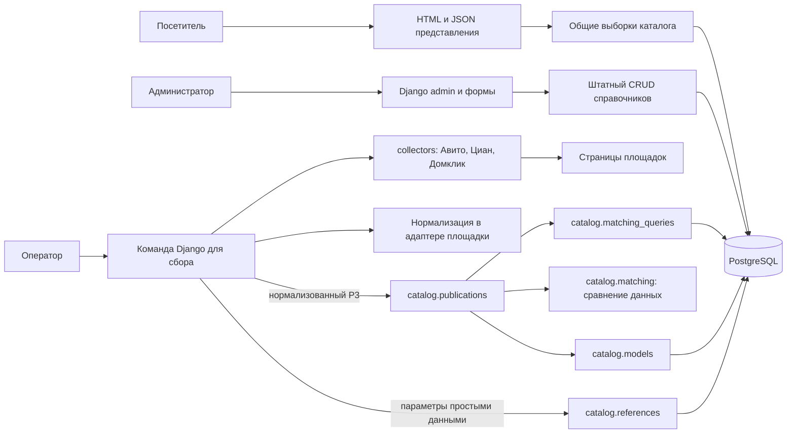
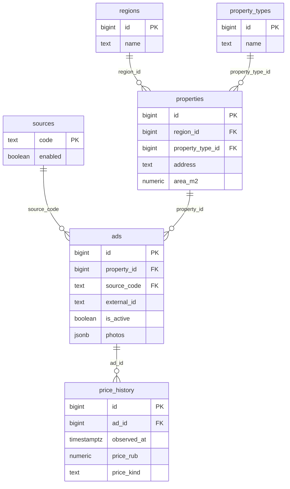
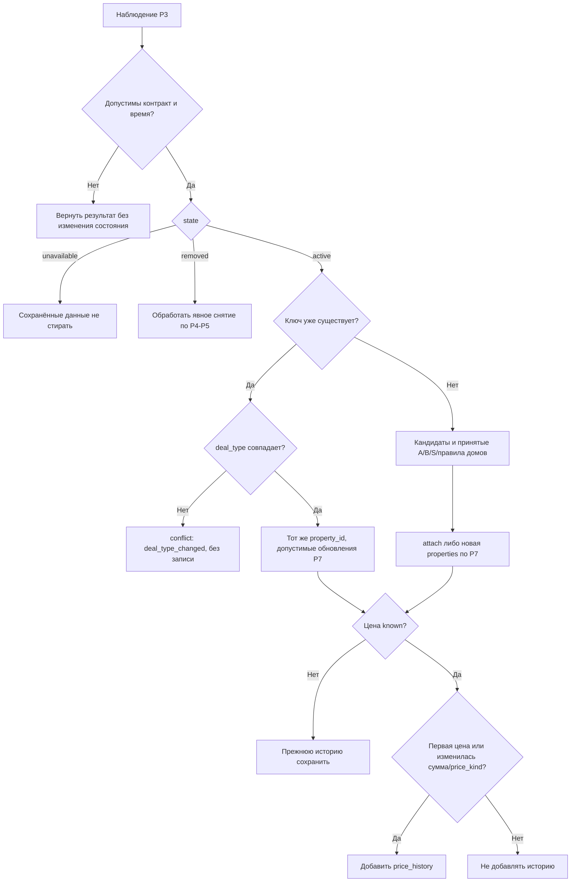
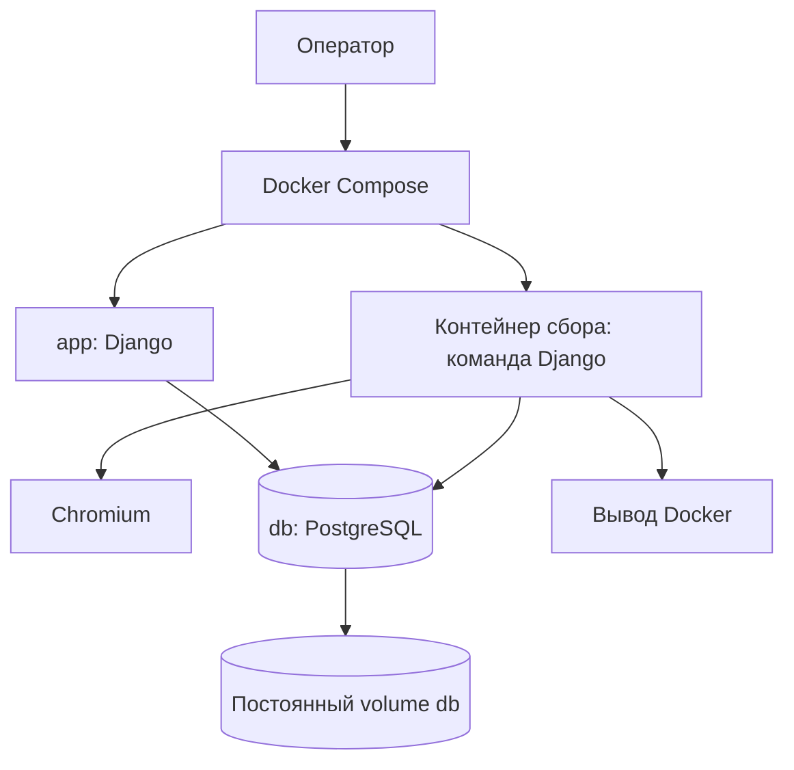

# 9 — сводный проект и итоговая сверка

Сводка объединяет принятые решения 1–9. Сайт и PostgreSQL работают через Docker Compose. Оператор запускает и останавливает сбор отдельной командой Django из терминала. Служебный вывод доступен через Docker.

## 9.1. Действующий проект: единый указатель решений

Это сводное описание. Детальные принятые контракты остаются в указанных документах; их поля/пороги/права не переопределяются сокращённой схемой. При споре проверить позднее прямое решение владельца и действующую спецификацию, а не брать старый TECHNICAL-DESIGN.md или исторический абзац.

| Область | Принятое решение | Точный источник |
|---|---|---|
| Назначение | Собирать жилую недвижимость из Авито/Циан/единого Домклик, нормализовать, автоматически сопоставлять, показывать каталог/карточку/JSON, управлять сбором. Продажа/месяц/сутки, квартиры/комнаты/дома. | [PLAN](PLAN.md), [НИР §§4–5](../thesis/nir/body.md), [источники 6](POINT6-REMAINING-DESIGN.md) |
| Архитектура | Один Django-проект, два apps: collection и catalog. Извлечение, нормализация и команда сбора отдельно от приёма/сопоставления/ORM/представлений. | [Структура](INDEPENDENT-STRUCTURE.md), [8.3 §2.1](QUALITY-8.3-PROPOSAL.md) |
| Данные | Только sources, regions, property_types, properties, ads, price_history плюс штатные Django-таблицы. Характеристики недвижимости в properties, публикационные сведения в ads; JSONB только принятого списка фото-URL. | [Пункт 2](DB-POINT2-VERIFIED-DRAFT.md) |
| Контракт P3/P7 | Одна публикация на входе, source/key/observed_at/state; active/removed/unavailable различаются. Для новой публикации matching решает attach/create и допустимый property_patch; повтор ключа сохраняет property_id. | [P3–P8](DB-POINT2-VERIFIED-DRAFT.md) |
| Атомарность/цены | Сериализованная атомарная запись, сеть до транзакции. Уникальный (source_code,external_id). История добавляется при изменении (price_rub,price_kind), прежние строки неизменяемы для runtime-роли. Новая недоступная цена не стирает прежнюю. Другой deal_type у прежнего ключа — conflict с reason=deal_type_changed. | [Пункт 2](DB-POINT2-VERIFIED-DRAFT.md), [суточные цены](DAILY-BASE-PRICES-6.4-PROPOSAL.md) |
| Сопоставление | Квартиры A/B с проверкой общих известных характеристик; комнаты строгий S, дома — принятые условия дома/блока/участка. Нехватка доказательств/противоречие не вынуждает attach. Принятые риски ошибок не превращаются в гарантию. | [Квартиры](MATCHING-PROPOSAL.md), [комнаты](ROOM-MATCHING-6.2-ACCEPTED.md), [дома](HOUSE-MATCHING-6.3-ACCEPTED.md) |
| Фото | Только URL; без файлов, хешей и обработки байтов. Сломанная ссылка/недоступный внешний ресурс не означает снятие объявления. | [Пункт 2](DB-POINT2-VERIFIED-DRAFT.md), [карточка](PROPERTY-CARD-PROPOSAL.md) |
| Получение | Playwright извлекает встроенные данные страницы; фактические семейства/ключи из 6.1/6.4, не выдуманный универсальный API. Исключение гостиничных номеров по проверенным признакам, не одному слову hotel. | [Нормализация](NORMALIZATION-4.2-PROPOSAL.md), [6](POINT6-REMAINING-DESIGN.md), [гостиничные номера](HOTEL-ROOMS-6.4-PROPOSAL.md) |
| Обход | Один последовательный run, один retry сети/5xx, 30 секунд на попытку; 401/403/429/служебная проверка завершают источник. Повтор ID сам не останавливает пагинацию. Повторный запуск идёт сначала, повторные записи не плодятся. | [4.3](COLLECTION-4.3-PROPOSAL.md) |
| Управление | Вход и справочники через Django admin. Сбор через команду Django в терминале, вывод через Docker. Удаление справочников блокируется во время сбора. | [5.4](ADMIN-SCREENS-PROPOSAL.md) |
| Интерфейс | Одна квартира с отдельными ads и ценами. Каталог группирует и пагинирует properties после фильтрации подходящих ads; карточка показывает все ads, в том числе снятые. Контекст поиска в URL, типы/ошибки HTML/API согласованы. | [Каталог](CATALOG-SCREEN-PROPOSAL.md), [карточка](PROPERTY-CARD-PROPOSAL.md), [JSON](JSON-5.5-CONTRACT-DETAILS.md) |
| Приёмка | F01–F25, включая повтор/историю/гонки/права БД. Локальная fixture, настоящая БД, браузер и живой источник — разные доказательства. | [7.1](ACCEPTANCE-7.1-PROPOSAL.md) |
| Исследование | 600 публикаций + отдельные 100 сложных реальных пар; независимая разметка/полный реестр, разделение групп 70/30. M0/M1/M2 на общем срезе, метрики/неопределённость/группы/затраты, 5 повторов и 5 порядков. Пользовательская проверка: 4 человека, по 3 задания каждым способом, без жёсткого лимита. | [7.2](RESEARCH-DATASET-7.2-PROPOSAL.md), [7.3](RESEARCH-METRICS-7.3-PROPOSAL.md), [7.4](USER-TIME-STUDY-7.4-PROPOSAL.md) |
| Качество | Ruff/mypy/djLint; strict весь собственный Python, включая тесты/миграции; слои, AAA, минимальные проверки по риску, pre-commit check-only, CI отдельно от живых площадок. | [8.1](QUALITY-8.1-PROPOSAL.md), [8.2](QUALITY-8.2-PROPOSAL.md), [8.3](QUALITY-8.3-PROPOSAL.md), [8.4](QUALITY-8.4-PROPOSAL.md) |
| Версии | Python3.13.18/Django5.2.19/PG17.12/psycopg3.3.9; mypy1.19.1/stubs-ext5.2.9; остальные точные pins/CI SHA/digest приняты. Подтверждённая metadata не равна совместной установке. | [8.5](QUALITY-8.5-PROPOSAL.md) |

### Сквозной пример

Новая публикация Циан: collector получает страницу и поля → normalization формирует P3 → команда сбора передаёт P3 в catalog.publications → внутри сериализованной операции проверяются время/ключ/поля, queries выбирает кандидатов, matching возвращает create либо attach/patch → атомарно сохраняются properties/ads/пригодная цена. Новая публикация Домклик той же квартиры присоединяется к property_id только при выполнении принятого правила; остаётся второй ads со своей ценой/описанием/URL. Ручного merge нет. Повтор того же ключа обновляет прежнюю ads, не ищет другой property_id. Точная последовательность проверок и исключений задаётся P3–P8, не сокращённым примером.

## 9.2. Схемы принятых решений — проектные представления

Ниже новые представления, не новые предметные правила. Mermaid — редактируемые исходники схем, не заявление о готовой вёрстке графического комплекта ВКР или соответствии блок-схем ГОСТ. Названия entities совпадают с БД, а не навязывают имена Python-классов.

### Схема компонентов и ответственности



Стрелка — зависимость/вызов, не направление копирования результатов; адаптер возвращает данные команде, нормализация формирует вход каталога. Допустимый прямой CRUD справочников не разрешает ручную правку связей/истории. Общие инварианты БД и запрет удаления при run действуют и здесь. Команда удерживает сессионную блокировку PostgreSQL.

### Логические связи БД



Поля сокращены только для читаемости схемы: полная физическая спецификация, NULL/UNIQUE/CHECK/FK/права в пункте 2. Это не предложение урезать таблицы. Ни group_id/duplicate_of_id, ни отдельной таблицы фото нет. Штатные auth/admin-таблицы Django в шесть предметных не входят.

### Последовательность приёма объявления

```mermaid
sequenceDiagram
    participant R as Команда Django collect
    participant C as collector
    participant N as normalization
    participant S as catalog.publications
    participant Q as queries
    participant M as matching
    participant D as PostgreSQL
    R->>C: Получить карточку
    C-->>R: Извлечённые данные или результат ошибки
    R->>N: Нормализовать полученные поля
    N-->>R: Нормализованные значения или ошибка разбора
    R->>S: Передать P3 при допустимом конверте
    Note over S,D: Проверки P3 и сериализованная атомарная операция P5
    S->>D: Найти публикацию по source/key и проверить observed_at
    alt снимок допускается к обработке и ключ новый
        S->>Q: Получить кандидатов
        Q->>D: Прочитать текущие свойства
        Q-->>S: Данные кандидатов
        S->>M: Сопоставить и определить допустимый patch
        M-->>S: attach/create/результат по P7
    else известный ключ либо снимок не допускается
        Note over S,D: Прежний property_id; ignored/rejected/conflict по P3-P8
    end
    S->>D: Разрешённые записи либо отсутствие изменений; commit/rollback
    S-->>R: outcome, ID при наличии, price_changed, причина
```

Это обобщённая схема: removed/unavailable не обязаны иметь полный active-набор и не запускают сопоставление новой недвижимости. Нормализация не заменяет причину ошибки значения на NULL; цена/фото имеют принятые частичные статусы. Если приём возвращает ignored/rejected/conflict, стрелка к DB означает отсутствие разрешённых изменений, а не обязательный commit новой строки.

### Схема решений при повторе и цене



Обобщение не меняет атомарность/порядок P5 и не вводит новые пороги. Подробные схемы нормализации, отдельных A/B/S/домов и обхода с пагинацией/остановкой оформляются по принятым алгоритмам в графический комплект; настоящее представление не выдаётся за все окончательные блок-схемы отчёта.

## 9.3. Маршруты и проверяемая связность

| Пользовательский проход | Маршруты | Контракт и приёмка |
|---|---|---|
| Найти и открыть объект | / → /catalog/ → /properties/<id>/ | Общие фильтры/пагинация 5.5, возвращение к результатам с URL-контекстом; F16–F18 по точной матрице 7.1 |
| Получить те же данные | /api/properties/ и /api/properties/<id>/ | JSON 5.5, decimal-строки/NULL/ошибки/пагинация; F18, доступ F19 по точной матрице 7.1 |
| Управлять запуском | Терминал, команда Django | Один сбор и остановка через терминал. Итог и ошибки в выводе Docker. |
| Источники/справочники | Штатные model admin разделы | Enabled и CRUD, запреты удаления/гонки и права F22/F25 |
| Выход | /admin/logout/ POST | Выход из админки по штатному сценарию Django. |

Имена F здесь — навигационная привязка, состав проверок определяет матрица 7.1. Django admin формирует маршруты справочников штатными средствами.

## 9.4. Принятая локальная эксплуатация

| Область | Принято и где определено |
|---|---|
| Образы/платформы | Python3.13.18-slim-bookworm и принятый digest, Desktop/Engine/Compose, Linuxarm64/amd64 — [профиль](CONTAINER-PROFILE-PROPOSAL.md), точные зависимости/PGimage — [8.5](QUALITY-8.5-PROPOSAL.md). |
| Подготовка/права | Подготовка через `tools/prepare-db.sh`: миграции под `migrator`, права по явному списку для `app`. Роль `app` не изменяет сохранённую историю цен. [Первый запуск](FIRST-LAUNCH-ROLES-PROPOSAL.md) |
| Начальные данные |3источника/3вида/89регионов, фиксированныеID, редактируемые подписи, штатное удаление и явное восстановление — [данные](INITIAL-DATA-PROPOSAL.md). |
| Сеть/процессы | Loopback, порт 8000 по умолчанию. Оператор задаёт свободный `APP_PORT`, если порт занят. db:5432 внутри. LinuxUID10001, bundledChromium/headless/sandbox, seccomp, init — [runtime](CONTAINER-RUNTIME-PROPOSAL.md). |
| Остановка | Отдельный контейнер выполняет `collect URL`. `Ctrl+C` останавливает его в переднем плане. Одновременный запуск и удаление справочников синхронизируются через PostgreSQL. [Остановка](PROCESS-LIFECYCLE-PROPOSAL.md) |
| Журнал и перезапуск | Ход, итог и ошибки видны в выводе Docker. Сбор после остановки запускается вручную. [Вывод и перезапуск](JOURNAL-STATE-RESTART-PROPOSAL.md) |
| Локальный web-профиль | Принятый runserver --noreload --insecure, DEBUG=false, обычный StaticFilesStorage/STATIC_URL, localhost/127.0.0.1 и устойчивый SECRET_KEY вне Git — [§2](FINAL9-RECONCILIATION-PROPOSAL.md). |

Compose содержит app с Django и db с PostgreSQL. Контейнер сбора создаётся командой оператора. Данные хранятся в томе db. При отсутствии сети остаются доступными сохранённые текстовые данные и цены.

### Схема размещения принятого проекта



Команда сбора использует образ `app` и подключается к тому же `db`.

## 9.5. Комплект ВКР и происхождение требований

| Результат | Что должно быть внутри | Основание/статус |
|---|---|---|
| Отчёт НИР | Обоснование средств, основные алгоритмы/схемы, основные модули, описание ПО и реальный листинг/результаты текущего этапа | Программа и ФОС НИР, пункты в аудите |
| Пояснительная записка ВКР | Предметная область/аналоги, задача, проект, реализация, исследование/расчёты, выводы/источники/приложения | Принятый полный план; точная кафедральная структура/объём не подтверждены содержательным пакетом ГИА |
| Схемы | Границы/варианты использования, логическая и физическая БД, взаимодействие/классы, основные алгоритмы и локальный запуск | Основные алгоритмы прямо в программе НИР; конкретный набор UML/ER и нотация — проект/уточнения преподавателя, не универсальная норма. Текущие схемы — исходники сводки; графическое оформление и недостающие детальные представления выполняются по принятым спецификациям |
| Руководство | Установка/запуск Compose, настройки, роли, поиск/карточка/JSON, сбор/журнал, ошибки; без обязательного backup/restore | Проектный результат плана; эксплуатационные детали 9.4 приняты, локальный web-профиль также принят |
| Программный комплект | Код, lock, миграции/ограничения/права, конфигурация-пример, тесты/демоданные, CODING/AGENTS, hooks/CI | Принятый проект 1–8 и доказательства для реализованной области |
| Исследовательский комплект | Происхождение/корпус, разметка/разделение, варианты методов, исходные измерения/расчёты/выводы; результаты 4 участников | Принятые 7.2–7.4; не заменяется фиктивными числами/оценкой критика |
| Показ и формальный комплект | Презентация/доклад/раздаточные материалы/показ, применимые титул/задание/отзыв/проверка текста/нормоконтроль/электронная передача | Общие документы ГИА/ЭБС и применимые формы, не доказательство выполненной сдачи |

Отчёт преподавателю самостоятельный: существенные сведения, схемы и результаты находятся внутри, ссылки на внутренние файлы проекта не заменяют содержание. Университету не приписываются выбранные технологии, пороги, 600/100, 4 участника, набор F01–F25, процент покрытия или оценка критика.

## 9.6. Граница готовности

Текущий локальный срез включает Compose для Django и PostgreSQL, подготовку ролей и схемы, приём снимка в каталог и команду `collect URL` для одной поддержанной карточки продажи квартиры на Циан. Полный обход источников, завершённые интерфейсы каталога и административных справочников, исследование и сдача оцениваются по соответствующим критериям и доказательствам.

Открытые вопросы о кафедральных требованиях, индивидуальном задании, составе ГИА и нормоконтроле отражены в [requirements-closure](requirements-closure.md).
