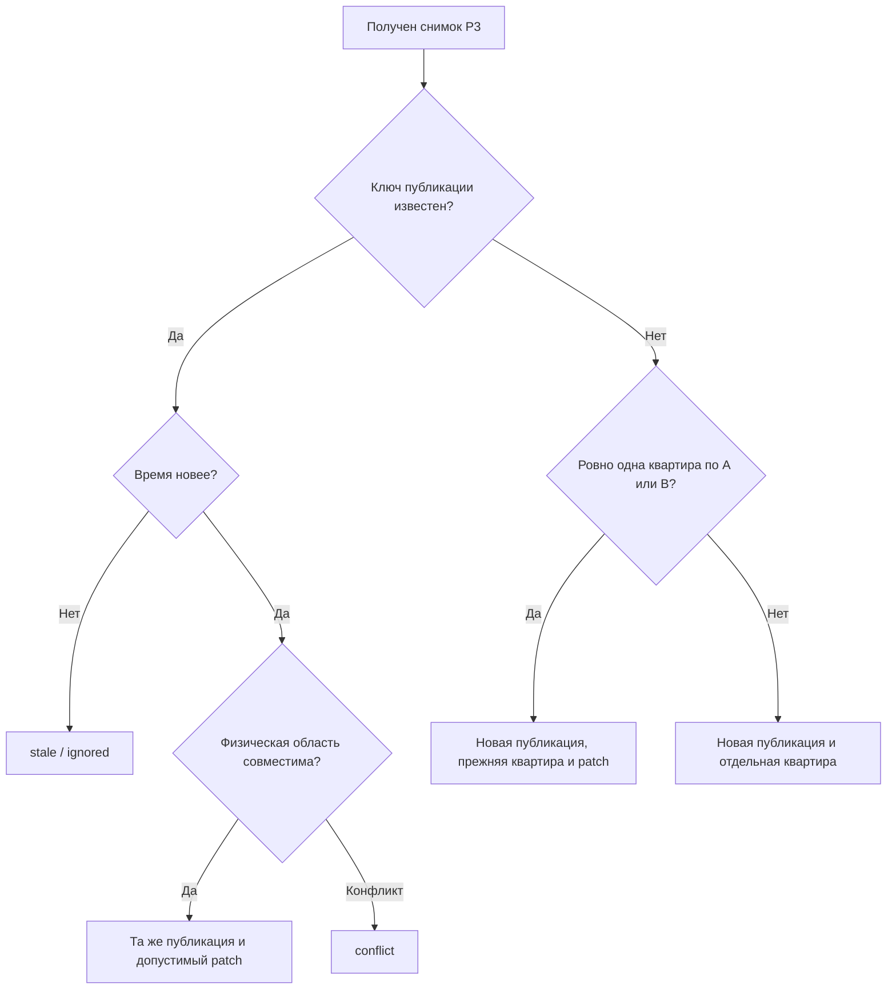

# Сопоставление квартир без хешей — принятые правила

17 ноября 2026. Правила A/B, совместимое дополнение адреса и риск ошибочного объединения явно приняты владельцем. Этап проектирования сопоставления квартир закрыт. В ходе проектирования код, SQL и парсер не создавались. Точность и полнота не измерены.

## Принято текущим ответом владельца

- Сравнивать общие характеристики: поле сравнивается, если известно с обеих сторон. NULL не считается ни совпадением, ни расхождением. Не требовать все возможные атрибуты площадок.
- Фото: только список URL; без phash/hash_version, обработки изображений, файлов и постоянного пересчёта. URL не используется как доказательство одной квартиры. Это явно заменяет прежнюю политику хешей.
- Приняты конкретные правила A/B, их минимальные условия, обработка противоречий/недостатка данных и совместимое уточнение адреса.

Пункт2 остаётся закрытым; в нём внесена только прямо согласованная поправка политики/формы photos. Никаких иных скрытых изменений структуры БД.

## 1. Область и общие проверки

Только квартиры. Повтор(source_code,external_id) обновляет прежнююads/property_id по принятомуконтракту; правиланиже применяютсякновойпубликации.
Кандидаты: одинregion_id,однозначныйнаселённыйпункт,одинполностьюустановленныйдомсучётомкорпуса/строения. Не угадыватьпропущенныечастиадреса. Координатымогутпомочьискатькандидатов,ноточкадома/районанеявляетсяидентификаторомквартиры.
Не сравниваем «квартиру»с «комнатой»какоднупредлагаемуюединицу.

Основной набор сравниваемых характеристик:area_m2,rooms,floor. Изнего берётсяпересечениедостоверноизвестныхполейобеихсторон. Например,есликомнатыестьтольконаЦиан,поэтомуодномуполюнеотклоняемДомклик. Цена,автор,числофотоссылок иdeal_typeне доказываюттождествофизическойквартиры.
Площадь — точныйdecimalпослеприведенияединиц,безпроизвольногодопуска:45.2=45.20,но45.2≠45.3. Дляработысразницамиокругленияпозженуженотдельновыбранныйиобоснованныйдопуск.

different:разныеявноустановленныедома/корпусаилипубликуемыеномераквартирводномдоме. Не применять номераизблокапохожихквартиркосновномуобъявлению.
uncertain:различаютсяобщиеосновныехарактеристики;неоднозначенадрес;недостаточноположительныхсвидетельств. Ошибкасайтане превращаетсявдоказанноразныйобъект.

## 2. ПравилоA — номер квартиры опубликован у обеих сторон

Объединяем при одновременном выполнении:
- совпалполныйадресдоквартиры,включаярегион/населённыйпункт/дом/номер;
- естьхотябыоднаобщаяосновнаяхарактеристика;всеобщиеизarea/rooms/floorсовпадают;
- нетявныхадресныхпротиворечий;
- соответствуетровнооднасуществующаяproperties.

Есливторойномернеопубликован,правилоAневыдумываетего,переходимкB.
Полныйадресв одиночкубезединойсопоставимойхарактеристикивэтомпредложениинедостаточен.

## 3. ПравилоB — номер квартиры отсутствует хотя бы у одной стороны

Принятое правило без изображений:
1. Полностьюсовпадаетдом;нетразныхизвестныхномеровквартир.
2. Уобеихсторонизвестныиточносовпадаютплощадьиэтаж. Этоминимальныеопорыдляслучаябезномера,не требованиевсехполей. Комнатысравниваютсятолькоеслиизвестныуобоих;ихразличиеостанавливаетобъединение.
3. ПолностьюсовпалнормализованныйтекстописанияИМЕННОквартирыотпродавца. Источникотдельнойсекциидолженбытьясен;текст«оЖК»,рекламасервиса,карточкасоседнейпланировкинеподставляютсявads.descriptionрадиэтогоправила. Еслиописаниянет/получентолькотекстЖК — Bне выполняется.
4. Чтобыкороткоешаблонное«продаётсяуютнаяквартира»недавалоположительныйрезультат, вполномописаниидолжныбытьявноуказаныразмерыхотядвухразныхвнутреннихпомещений(напримеркухня28м²испальня24м²). Общаяплощадьквартирыиномерэтажаэтизнакитекста не заменяют. Повтородногоитогожеразмераодногопомещениядваждынесчитаетсядвумяпомещениями. Еслитакиесведениянельзяоднозначноизвлечь — Bне выполняется.
5. Если этот же нормализованный seller-текст уже наблюдается у квартир с явными разными номерами в одном доме, он считается шаблонным и не используется как положительное свидетельство B. Это проверка доступных записей, не обещание узнать все будущие копии.
6. Условиявыполненыдляровнооднойсуществующейproperties;сравнениеполногоописаниявыполняетсясоднойконкретнойсохранённойadsэтойproperties,анесобраннымизкусковтекстомразныхобъявлений.

Нормализациятекстаубираеттолькоразличияоформления:регистр,ё/е,эквивалентныетипографскиекавычки/маркеры,эмодзи,повторныепробелыипереносы. Границы слов сохраняются: серии пробельных символов сжимаются в один пробел, не удаляются; «не жил» не превращается в «нежил». Слова/числа/отрицания/размерыневыкидываются. Десятичныезначениянельзясклеиватьудалениемпунктуации. Этострогоеполноесравнение,непроизвольныйпроцент«похожести».
Изменённаяформулировкаописанияможетдатьuncertainдажедляоднойквартиры;этосознательнопропущенныйдубль,а неповодпридуматьсовпадение.

B — эвристика, а не доказательство. Разные квартиры могут иметь скопированные подробные описания и одинаковые основные признаки, особенно при типовых планировках. Даже правило двух внутренних размеров и доступная проверка шаблонов этого не исключают. Нельзя обещать отсутствие ложных объединений или считать эти два размера научно подобранным порогом. Это принятое проектное правило с явным согласием владельца на риск; не норматив университета и не доказанная точность. Риск не блокирует закрытие проектирования, но подлежит измерению в исследовательской части.

Различающийсяdeal_typeдвухразныхadsсампосебенеблокируетоднуквартиру(одноможетпродаваться,другоесдаваться). Историинеобъединяются. Повторсвоейadsсновымdeal_typeподчиняетсяпринятомуconflict/deal_type_changed.

## 4. Мало данных, неоднозначность, сохранение свойств

ЕслиA/Bневыполнены,естьпротиворечияилиположительноподходятнесколькоproperties — отдельнаяpropertiesиноваяads. Не выбиратьпервыйID,не создаватьручнуюочередь,не выдаватьразныеIDзадоказанноразныереальныеквартиры.
Безномераквартирысовпадениетолькодома/площади/этажанеобъединяет. Пустоеописаниенеравнопустомуописаниюкакположительныйпризнак.
Существующиеpropertiesнесливаем,известныеadsнеперепривязываем. Дляновойadsразрешеноискатьсредиуже присоединённыхпубликаций,нонетобещаниядоказаннойтранзитивностицепочектекстовыхсвязей.
Принятый patch: для обычных физических полей заполнять только NULL, не перезаписывать известные значения. Для составного address отдельно разрешить совместимое уточнение ранее неизвестных частей (номер квартиры/подъезд/корпус) даже при непустом address: все уже известные компоненты должны сохраниться и согласоваться. Новый известный номер квартиры после положительного сопоставления обязательно сохраняется в properties.address в той же транзакции. Нельзя подменить №121 на №1 или известный корпус другим; конфликт блокирует присоединение. Если новые части нельзя однозначно разобрать/сохранить без потери прежних, не объединяем автоматически. Это допустимый property_patch принятого интерфейса, не новые колонки. До присоединения каждой следующей ads сравниваем её со всем накопленным адресом properties. Правило patch принято вместе с правилами сопоставления.

## 5. Проверка на реальных страницах 17 ноября

Факты и границы: evidence/field-audit/matching-url-only-checks.json.
Это прочитанныеживыестраницыиручнойразборправилнаданных,неиспытаниеприложения. Строковоеравенстводвухполныхописанийпровереноинструментомбразуера,хешейнет.

- Циан333842107 иДомклик2080269220:Буянова120,110м²,12этаж,3комнаты. Полныеseller-описания2270/2279символов;послеудаленияоформленияобапо2225символов,полностьюравны. Втекстеестькухня-гостиная28м²,спальни24/23м²,прихожая19.1м²,санузел8.3м². УсловияBнаэтихнаблюденияхвыполняютсяприодномкандидате;ожидаетсяобщийproperty_id. Это не кадастроваяпроверка,не измереннаяточностьалгоритма.
- Домклик2072470551 и2072470531:одинаковы54.3м²/2комнаты/этаж2,ноосновныекарточкиявнопоказывают№121/подъезд2и№1/подъезд1. different,необъединяем. Совпадающийтекст находитсявсекцииоЖК,оннеподходитдляB.
- Циан330631159:47.21м²,1комната,этаж2,ноадрестолькообласть/город/район. Домустановитьнельзя;недостаточноданныхдляA/B. НаличиеЖКнеподменяетномерадома.

Отдельныемысленныестресс-проверки,НЕфактысайтов:скрытьroomsуоднойстороныБуянова — результатнеобязанизмениться;скрытьseller-описание —Bне выполняется;скрытьномерадвухновостроек —общийтекстоЖКвсёравнонепроходитB.

## 6. Фото и соответствие описанию работы

URLтолькодляотображения/перехода,непризнаксовпадения/различия. Ссылкимогутразличатьсяуодногоизображенияисовпадатьуразныхквартир.
НеполученныйсписокURLсохраняетпрежний,подтверждённыйпустойочищает;photos_observed_at—времясписка. Хеши/версиихешейисключеныизактуальногопроекта,колонкиновыенедобавлены.

ИсходныйНИР§5.2упоминалперцептивныехеши. Пользовательявновыбралдругойспособ. ОригиналНИРнеподменяется:актуальное описание ВКР в PLAN.md обновлено: структурные характеристики и тексты объявлений; фото отображаются по URL. Это изменение собственного проектного требования по прямому решению владельца,не утверждение,чтоНИРвсегдаговорилтак. ОтдельногомандатауниверананакапливаниеpHashнеустановлено. Авитопо-прежнемуотложено.

Методпопарногосравненияполейсразличнымиуровнямисходстваописанвпервоисточнике:
https://moj-analytical-services.github.io/splink/topic_guides/comparisons/comparisons_and_comparison_levels.html
Источниктакжеобъясняет,чтоопределениесходствавыбираетсяподпредметнуюобласть;онНЕдоказываетнашипорогиилиспецифическиеправилаB. Splinkкакзависимостьневыбран.

## Статус

Все изложенные правила A/B и patch приняты владельцем 17 ноября2026 вместе с риском ошибочного объединения. Проектирование сопоставления квартир закрыто. На этапе проектирования правила оценивались без кода. Текущая реализация и проверки описаны ниже. Точность и полнота остаются задачей исследования.

## Проверка адресного уточнения после отзыва
Логическийпример,нефактсайта:propertyадресБуянова120,номернеизвестен→новаяads№121сдостаточнымиBсвидетельствами→единымpatchадресстановитсяБуянова120,кв121→следующаяads№1получаетdifferentпопротиворечиюснакопленным№121. Еслисохранитьновыйномернеполучается,attachневыполняется. Это принятое уточнение сохранения адресных свидетельств.

## Риск, принятый владельцем
Даже совпадение подробного seller-текста, размеров помещений и основных характеристик не гарантирует одну реальную квартиру: текст может быть скопирован. При выполнении B система всё равно автоматически присоединяет публикацию к единственному подходящему объекту. Владелец явно принял этот риск; его вероятность не измерена. При недостатке данных выполняется другая ветка — отдельная properties, то есть возможен пропуск настоящего дубля. Эти два вида ошибок различаются при оценке качества.

## Реализация T19

Правила A/B проверяет `catalog.matching` на данных одной квартиры и её публикаций.
Разбор строки выполняет `catalog.address_parser`. Разобранные адреса
сравнивает и дополняет `catalog.address`. Доказательства по описанию
проверяет `catalog.seller_description`.
`catalog.matching_queries` выбирает кандидатов того же региона и вида вместе с отдельными
seller-описаниями. При положительном результате у одной квартиры появляются две
публикации, каждая со своей ценой и историей.

Приём P3 проверяет время известного ключа перед сопоставлением. Дополнение адреса
и физических характеристик входит в ту же транзакцию, что публикация и цена.
Проверки F07/F24 выполняются на PostgreSQL под ролью `app` через
`cd implementation && bash tests/compose.sh`.

При разборе адреса район служит уточнением населённого пункта. Два уличных
компонента или район без населённого пункта оставляют адрес неопределённым.
Согласованные уточнения типа населённого пункта и района сохраняются с адресом.
Отбор кандидатов и проверка шаблонного текста используют одно сравнение дома.
Различающиеся известные уточнения исключают пару из проверки шаблона.
Полные описания сравниваются после выравнивания оформления. В доступном
входе нет подтверждённого структурированного списка размеров помещений.
Реализация B принимает явный список из названия и положительной площади
помещения, с допустимым заголовком планировки. Номера различают однотипные
помещения. Непронумерованная «комната», повтор или перекрывающиеся
названия одного помещения не доказывают второе помещение. Совмещённая
кухня-гостиная считается одним помещением. Свободный текст с примечаниями, условиями сделки или указанием
на другую квартиру не подтверждает размеры. В таких случаях правило B
оставляет публикации раздельно. Описание объявления хранится целиком.

